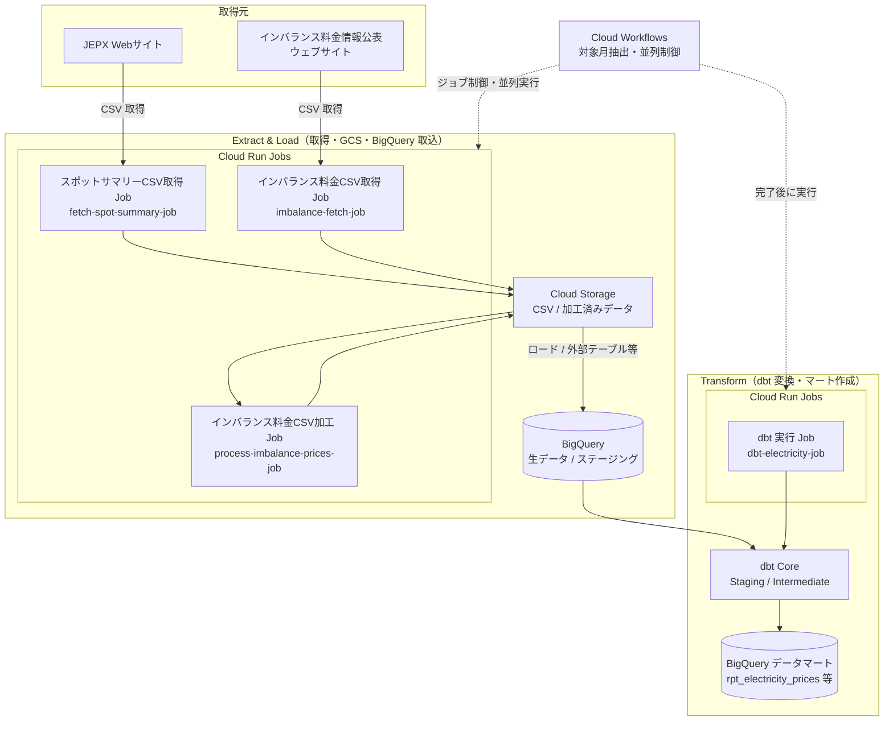

# GCPを使用した ELT Pipeline

JEPX（スポット市場サマリー）およびインバランス料金の CSV データを取得し、Google Cloud Storage (GCS) と BigQuery を経由して dbt でデータマートを構築する ELT パイプラインです。Cloud Run Jobs で各処理を実行し、Cloud Workflows で並列実行や依存関係を制御します。

---

## 全体図



---

## ディレクトリ構成

```text
jepx_imbalance/
├── dbt_electricity/                  # dbt プロジェクト
├── scripts/
│   ├── fetch_imbalance_prices/       # インバランス料金データ取得ジョブ関連
│   │   ├── .dockerignore
│   │   ├── Dockerfile
│   │   ├── build_image.py            # Docker イメージをビルド・プッシュするスクリプト
│   │   ├── fetch_imbalance_prices.py # インバランス料金データ取得スクリプト
│   │   └── requirements.txt
│   ├── fetch_spot_summary/           # スポット市場価格取得ジョブ関連
│   │   ├── Dockerfile
│   │   ├── build_image.py            # Docker イメージをビルド・プッシュするスクリプト
│   │   ├── deploy_job.py             # Cloud Run Jobs をデプロイするスクリプト
│   │   ├── fetch_spot_summary.py     # スポット市場価格取得スクリプト
│   │   └── requirements.txt
│   ├── process_imbalance_prices/     # インバランス料金データ加工ジョブ関連
│   │   ├── Dockerfile
│   │   ├── build_image.py            # Docker イメージをビルド・プッシュするスクリプト
│   │   ├── deploy_job.py             # Cloud Run Jobs をデプロイするスクリプト
│   │   ├── process_imbalance_prices.py # インバランス料金データ加工スクリプト
│   │   └── requirements.txt
│   └── utils/
│       └── cloud_build.py            # Cloud Build 共通処理
├── .env                              # 環境変数定義（Git 管理対象外）
├── .gitignore
├── deploy_workflow.py                # Cloud Workflows デプロイスクリプト
├── README.md
├── requirements.txt
└── workflow.yaml                     # ETL パイプラインを定義する Cloud Workflows 設定ファイル
```

---

## 1. アーキテクチャ概要

1. **対象月の抽出**: Cloud Workflows から BigQuery を参照し、処理対象となる年月（`TARGET_MONTHS`）を抽出します。
2. **並列取得・加工**: インバランス料金系（取得 → 加工）とスポット市場価格取得を並列ブランチで実行し、CSV や加工済みデータを GCS バケット（`GCS_BUCKET`）へ格納します。
3. **変換・マート作成**: 並列処理の完了後、Cloud Run Jobs 上の dbt プロジェクト（`dbt_electricity`）を実行し、BigQuery 上に分析用マートを作成します。
4. **セキュリティ**: 専用のサービスアカウント（`etl-worker`）を使用し、ログ出力・ジョブ実行権限と対象 GCS バケットへの書き込み権限を最小権限で管理します。

---

## 2. 環境変数

ジョブ実行時やローカル設定（`.env`）で扱う主な環境変数です。

| 変数名 | 説明 | 例 |
| :--- | :--- | :--- |
| `GCS_BUCKET` | 取得・加工データの格納先 GCS バケット名 | `elenmikasa` |
| `TARGET_MONTHS` | 処理対象の年月（ワークフローから渡す場合はカンマ区切り等） | `202610` |

---

## 3. デプロイ・構築手順

### ① サービスアカウントの作成
1. Google Cloud コンソールから **「IAM と管理」 > 「サービスアカウント」** を開く。
2. 「サービスアカウントを作成」をクリックし、基本情報を入力する。
   - **Service account name**: `ETL Worker`
   - **Service account ID**: `etl-worker`
   - **Service account description**: `ETL処理全般用`
3. 「Create and continue」を押し、**「Permissions」** で以下のロールを付与して作成を完了する。
   - **Logs Writer** (`roles/logging.logWriter`)
     - **意味**: Cloud Logging に対してログ（出力メッセージなど）を書き込む権限。
     - **用途**: コンテナ内で実行された Python スクリプトの実行ログや標準出力を Google Cloud 上で記録・確認するために必要。
   - **Cloud Run Invoker** (`roles/run.invoker`)
     - **意味**: Cloud Run のサービスやジョブを実行（起動・呼び出し）する権限。
     - **用途**: Cloud Scheduler、Cloud Workflows、または手動実行時、ジョブがタスクを安全に起動・制御するために必要。

### ② GCS バケットの権限設定
1. 対象の GCS バケット（`elenmikasa`）の詳細画面を開き、**「権限 (Permissions)」** タブを選択する。
2. **「アクセス権を付与 (Grant access)」** をクリックする。
3. **新しいプリンシパル**: 作成したサービスアカウント（`etl-worker@<project-id>.iam.gserviceaccount.com`）を指定する。
4. **ロールを選択**: `Cloud Storage` > **「Storage Object Admin（ストレージ オブジェクト管理者）」** を選択して保存する。

### ③ Docker イメージのビルドと Artifact Registry へのプッシュ
各ジョブの `build_image.py` または `gcloud builds submit` を使って、コンテナイメージを Artifact Registry に登録します。
```bash
# 例: Cloud Build でビルドする場合
gcloud builds submit --tag asia-northeast1-docker.pkg.dev/<project-id>/etl-repo/imbalance-fetch:latest .
```

### ④ Cloud Run Jobs・Workflows の作成／デプロイ
各ジョブの `deploy_job.py`（または Cloud Run コンソール）でジョブを作成し、`deploy_workflow.py` で `workflow.yaml` をデプロイします。コンソールから個別に作成する場合は以下の設定を行います。
1. Google Cloud コンソールの **「Cloud Run」 > 「ジョブ (Jobs)」** に移動し、「ジョブを作成 (Create job)」をクリックする。
2. **コンテナイメージの URL**: Artifact Registry にプッシュした対象イメージを選択する。
3. **ジョブ名**: `imbalance-fetch-job` などを入力する。
4. **リージョン**: `asia-northeast1 (Tokyo)` を選択する。
5. **セキュリティ (Security)** タブで、サービスアカウントに `ETL Worker` を選択する。
6. **コンテナ (Containers)** タブ内の「Variables & Secrets」で、環境変数（`GCS_BUCKET`、`TARGET_MONTHS` など）を設定する。
7. 「作成 (Create)」をクリックする。

---

## 4. 実行方法

### 手動実行
Cloud Workflows または Cloud Run Jobs の画面から実行できます。Cloud Run Jobs の詳細画面から **「Execute（実行）」** ボタンをクリックして単体実行することも可能です。
- 成功すると Tasks overview に `1 Succeeded`、終了コード `Last exit code: 0` が表示されます。

### 自動実行（定期実行）の追加
Cloud Scheduler と連携させることで、定期実行をトリガーできます。
1. Cloud Workflows または Cloud Run Jobs のトリガー設定、または Cloud Scheduler コンソールからスケジュール（Cron 形式）を設定します。